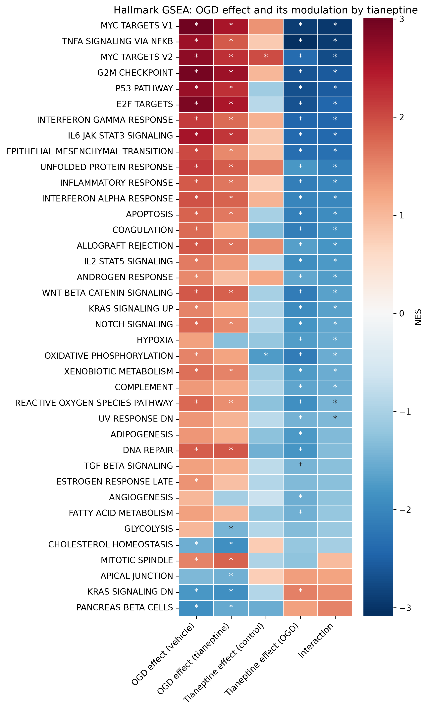

# Tianeptine and oxygen-glucose deprivation: bulk RNA-seq re-analysis in Python

Independent re-analysis of my own published bulk RNA-seq data on the neuroprotective effect of the atypical antidepressant **tianeptine** in an in vitro model of ischaemic stroke (**oxygen-glucose deprivation, OGD**).

In the original study ([Ersoy et al., 2024](https://doi.org/10.1007/s00406-023-01685-9)), the RNA-seq analysis was performed by an external service provider using the R/Bioconductor package DESeq2. Here I re-analysed the data myself, starting from the raw count matrix, with a fully Python-based workflow: quality control, differential expression with PyDESeq2 (the Python implementation of DESeq2), over-representation analysis and gene set enrichment analysis. The analysis reproduces the main published findings and extends them with direction-specific pathway analysis and a formal test of the OGD × tianeptine interaction.

## Key finding



OGD induced a strong inflammatory, p53/apoptotic, oxidative stress and proliferative (likely glial) response. In healthy cultures, tianeptine had almost no effect on these programmes. **Under OGD, tianeptine selectively attenuated them** (26 Hallmark gene sets with a significant interaction, FDR < 0.05), even though no single gene showed a significant interaction. This is a context-dependent molecular signature consistent with neuroprotection.

## Data

- **Model:** Primary mouse cortical cultures exposed to 3 h of oxygen-glucose deprivation (OGD) or control conditions.
- **Treatment:** Tianeptine (10 µM) or vehicle was added 24 h before OGD (pretreatment). During the 3 h OGD (glucose-free BSS0) or control incubation (glucose-containing BSS20), no drug was present. Afterwards, the tianeptine- or vehicle-containing medium was returned to the cultures for the 6 h reoxygenation period until RNA collection.
- **Sampling:** RNA was collected 6 h after the end of OGD.
- **Design:** 4 groups (CONTROL-VEH, CONTROL-TIA, OGD-VEH, OGD-TIA), n = 4 per group, 16 samples.
- **Raw data:** GEO accession [GSE234798](https://www.ncbi.nlm.nih.gov/geo/query/acc.cgi?acc=GSE234798). The count matrix is not included in this repository.

## Reference

Ersoy B, et al. The atypical antidepressant tianeptine confers neuroprotection against oxygen–glucose deprivation. *Eur Arch Psychiatry Clin Neurosci.* 2024;274:777–791. [doi:10.1007/s00406-023-01685-9](https://doi.org/10.1007/s00406-023-01685-9)

## Analysis workflow

| Notebook | Content |
|---|---|
| [`01_QC_PCA.ipynb`](notebooks/01_QC_PCA.ipynb) | Isoform-to-gene aggregation, low-count filtering, CPM normalisation, sample correlation, hierarchical clustering, PCA |
| [`02_DE_analysis.ipynb`](notebooks/02_DE_analysis.ipynb) | Differential expression with PyDESeq2 (`~group`), four pairwise contrasts and an OGD × tianeptine interaction contrast, volcano plots, Venn diagram, comparison with qPCR |
| [`03_pathway_analysis.ipynb`](notebooks/03_pathway_analysis.ipynb) | Over-representation analysis (g:Profiler, mouse GO:BP and KEGG, custom background), gene set enrichment analysis (gseapy prerank, MSigDB mouse Hallmark), summary heatmap |

## Main results

**Quality control**
- 18,665 genes passed filtering (≥ 10 reads in ≥ 4 samples).
- Samples clustered by treatment and by experimental week (one sample per group per week).

**Differential expression** (padj ≤ 0.05, |log2FC| ≥ 1)
- OGD changed **1,832 genes** in vehicle-treated cultures and **292 genes** in tianeptine-treated cultures (published analysis: 1,675 and 445).
- No single gene showed a significant OGD × tianeptine interaction.

**Over-representation analysis (g:Profiler)**
- Upregulated genes after OGD were enriched in inflammation, p53/apoptosis, oxidative stress and cell cycle pathways. Downregulated genes were enriched in neuronal receptor, calcium/cAMP and synaptic signalling.
- **14 of the 16 KEGG pathways** reported in the original publication were reproduced. Analysing up- and downregulated genes separately (not done in the original analysis) clarified the direction of each pathway and recovered pathways lost in the combined analysis.

**Gene set enrichment analysis (MSigDB mouse Hallmark)**
- OGD increased the same inflammatory, p53/apoptotic, stress and proliferative programmes in vehicle- and tianeptine-treated cultures, showing that the smaller ORA results under tianeptine largely reflected lower statistical power.
- Tianeptine changed only 2 of 50 gene sets in control cultures, but 32 gene sets in OGD-exposed cultures.
- The interaction analysis identified 26 gene sets whose OGD induction was significantly weaker with tianeptine, most strongly **TNFα signalling via NF-κB, MYC targets, p53 pathway, G2M checkpoint, interferon γ response, IL6/JAK/STAT3 signalling and epithelial-mesenchymal transition**.

## Limitations

- Small sample size (n = 4 per group).
- Experimental week (batch) was inferred from expression data and not included in the statistical model.
- Pre-ranked GSEA does not account for correlation between genes within a set, so FDR values may be optimistic.
- The Hallmark collection contains no neuron-specific gene sets.
- Changes in transcript levels do not directly demonstrate functional effects.

## Repository structure

```
├── data/
│   └── metadata.csv          # sample annotation (group, condition, treatment, GEO accession)
├── notebooks/
│   ├── 01_QC_PCA.ipynb
│   ├── 02_DE_analysis.ipynb
│   └── 03_pathway_analysis.ipynb
└── results/
    ├── gene_counts_filtered.csv
    ├── DE_*.csv              # differential expression tables for all contrasts
    └── GSEA_hallmark_heatmap.png
```

## How to run

1. Download the count matrix from [GSE234798](https://www.ncbi.nlm.nih.gov/geo/query/acc.cgi?acc=GSE234798) and save it as `data/isoforms.matrix.counts.csv`.
2. Create a Python 3.12 environment and install the dependencies:
   ```bash
   pip install pandas numpy matplotlib seaborn scikit-learn pydeseq2 matplotlib-venn gprofiler-official gseapy lxml jupyter
   ```
3. Run the notebooks in order (01 → 02 → 03). Notebook 03 requires an internet connection (g:Profiler and MSigDB).

## Tools

Python 3.12 · pandas · NumPy · Matplotlib · seaborn · scikit-learn · PyDESeq2 · g:Profiler · gseapy · MSigDB

## Author

**Burcu Ersoy**, PhD (Charité – Universitätsmedizin Berlin)
